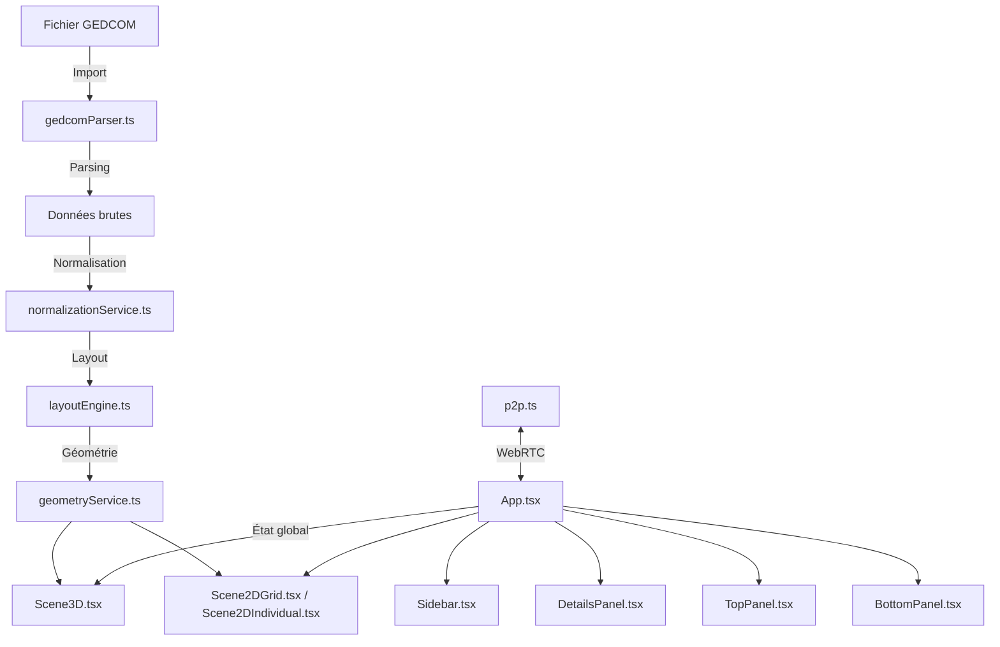

<div align="center">

# 🧬 **LifeThread** — Le Fil de la Vie

### Visualisez votre généalogie comme un fil dans le temps et l'espace

*Each life is a thread — woven through time and space.*

[](https://www.typescriptlang.org/)
[](https://react.dev/)
[](https://threejs.org/)
[](https://vitejs.dev/)
[](#)
[](#licence)

<!-- TODO: Ajouter des captures d'écran du projet

-->

</div>

---

## Concept / Vision

**LifeThread** est une application web de visualisation généalogique basée sur le concept du **Time-Space Cube** : chaque individu est représenté par un fil coloré dont la longueur correspond à sa durée de vie, disposé dans un espace tridimensionnel où le temps s'écoule verticalement.

Imaginez un cube dans lequel chaque fil représente une vie humaine — sa naissance, sa mort, ses liens familiaux — le tout visualisé simultanément sur des centaines d'années et des dizaines de milliers d'individus.

> **La métaphore** : Chaque personne est un fil. Les fils s'entrelacent pour former le tissu d'une famille, d'une lignée, d'une histoire.

---

## Fonctionnalités principales

### Visualisation 3D
- **Cube temps-espace** : axe vertical = temps, plan horizontal = espace familial
- **Rendu GPU** via `InstancedMesh` — un seul draw call pour 40 000+ individus
- **Vues multiples** : perspective libre, vue de dessus, vue isométrique
- **Navigation** : rotation, zoom, pan avec la souris

### Timeline 2D
- **Frise chronologique interactive** avec grille temporelle
- **Marqueurs d'événements** : naissances, décès, mariages
- **Pan/zoom fluide** pour explorer les différentes époques

### Import / Export GEDCOM
- Support des encodages **ANSI et UTF-8**
- Parsing robuste des fichiers `.ged` standard
- Export des données traitées

### Normalisation des dates
- **Calcul statistique** des dates manquantes (naissance/décès)
- Estimation intelligente basée sur les relations familiales
- Comparaison données originales vs normalisées

### Compaction intelligente
- Algorithme d'**optimisation spatiale** réduisant l'espace de 25 à 35 %
- **Nesting** intelligent des branches pour un rendu plus dense
- **10 presets configurables** (compact max, équilibré, aéré, etc.)

### Synchronisation P2P
- **Partage en temps réel** via WebRTC (PeerJS)
- Aucun serveur nécessaire — communication directe entre navigateurs
- Synchronisation de l'arbre, de la sélection et de la caméra

### PWA (Progressive Web App)
- Application **installable** sur desktop et mobile
- Utilisable **hors ligne** après la première visite

### Thème clair / sombre
- Détection automatique des **préférences système**
- Basculement manuel possible

---

## Captures d'écran

<!-- TODO: Remplacer les placeholders ci-dessous par de vraies captures d'écran

### Vue 3D — Arbre déployé


### Timeline 2D


### Panneau de détails


### Mode sombre


-->

*Captures d'écran à venir.*

---

## Stack technique

| Technologie | Rôle |
|---|---|
| **React 18** + **TypeScript** | Interface utilisateur et typage |
| **Three.js** + **React Three Fiber** + **Drei** | Rendu 3D et scène WebGL |
| **Vite** | Build et dev server ultra-rapide |
| **Tailwind CSS** | Styles utilitaires |
| **PeerJS** (WebRTC) | Synchronisation pair-à-pair |
| **Vite Plugin PWA** | Support hors-ligne et installation |
| **Lucide React** | Icônes |

---

## Démarrage rapide

**Prérequis** : [Node.js](https://nodejs.org/) (v18+)

```bash
git clone https://github.com/<votre-utilisateur>/lifethread.git
cd lifethread
npm install
npm run dev
```

L'application sera accessible sur `http://localhost:5173`.

### Build de production

```bash
npm run build
npm run preview
```

---

## Utilisation

1. **Importer un fichier GEDCOM** : cliquez sur le bouton d'import et sélectionnez un fichier `.ged`
2. **Naviguer en 2D/3D** : basculez entre les vues via les boutons en haut de l'écran
3. **Explorer l'arbre** :
   - Cliquez sur un individu pour voir ses détails
   - Utilisez les flèches `<` (ancêtres) et `>` (descendants) pour explorer la lignée
4. **Normaliser les dates** : activez la normalisation pour combler les dates manquantes
5. **Partager en P2P** : générez un identifiant de session et partagez-le pour collaborer en temps réel

---

## Architecture



### Fichiers clés

| Fichier | Description |
|---|---|
| [`App.tsx`](App.tsx) | Composant principal, gestion d'état et orchestration |
| [`components/Scene3D.tsx`](components/Scene3D.tsx) | Visualisation 3D (Three.js / R3F) |
| [`components/Scene2DGrid.tsx`](components/Scene2DGrid.tsx) | Vue 2D moderne (grid + photo/ruban + interactions) |
| [`components/Scene2DIndividual.tsx`](components/Scene2DIndividual.tsx) | Façade de la vue 2D individual (pipeline `Scene2DGrid`) |
| [`components/Scene2DTimeline.tsx`](components/Scene2DTimeline.tsx) | Frise chronologique détaillée |
| [`components/InstancedGenealogyTree.tsx`](components/InstancedGenealogyTree.tsx) | Rendu GPU instancié pour la 3D |
| [`services/gedcomParser.ts`](services/gedcomParser.ts) | Parsing des fichiers GEDCOM |
| [`services/layoutEngine.ts`](services/layoutEngine.ts) | Algorithme de layout et compaction |
| [`services/normalizationService.ts`](services/normalizationService.ts) | Normalisation statistique des dates |
| [`services/geometryService.ts`](services/geometryService.ts) | Calcul des géométries 3D |
| [`services/p2p.ts`](services/p2p.ts) | Service de synchronisation P2P (PeerJS) |
| [`types.ts`](types.ts) | Modèle de données TypeScript |

---

## Algorithme de compaction

LifeThread intègre un algorithme de compaction spatial unique :

- **Réduction de 25 à 35 %** de l'espace horizontal occupé
- **Nesting intelligent** : les branches courtes sont imbriquées dans les espaces laissés par les branches longues
- **10 presets configurables** : de la compacité maximale à l'affichage aéré, chaque preset ajuste la densité, les gaps et le facteur de nesting

```
Preset 1 — Compact Max    : gain ~35-40%, lisibilité ⭐⭐⭐
Preset 2 — Équilibré      : gain ~25-30%, lisibilité ⭐⭐⭐⭐   (recommandé)
Preset 3 — Aéré           : gain ~15-20%, lisibilité ⭐⭐⭐⭐⭐
...
```

---

## Performances

| Taille de la base | Vue 2D (DOM) | Vue 3D (WebGL) |
|---|---|---|
| < 1 000 individus | Fluide | Fluide |
| 1 000 – 5 000 | Correct | Fluide |
| 5 000 – 40 000+ | Non recommandé | Fluide (InstancedMesh) |

- **Petites bases** (< 5 000) : la vue 2D DOM offre une expérience interactive riche
- **Grandes bases** (5 000+) : le rendu 3D via `InstancedMesh` permet d'afficher 40 000+ individus en un seul draw call GPU

---

## Roadmap

- [ ] Synchronisation incrémentale P2P avec CRDTs
- [ ] Web Workers pour le parsing et le layout
- [ ] Import depuis d'autres formats (Gramps XML, JSON)
- [ ] Annotations et médias sur les individus
- [ ] Scene 2D Canvas pour les très grandes bases
- [ ] Basculement automatique DOM / Canvas selon la taille
- [ ] Spatial indexing (Quadtree) pour le culling

---

## Contribuer

Les contributions sont les bienvenues ! N'hésitez pas à :

1. **Fork** le projet
2. Créer une **branche** pour votre fonctionnalité (`git checkout -b feature/ma-feature`)
3. **Commit** vos changements (`git commit -m "feat: description"`)
4. **Push** vers votre branche (`git push origin feature/ma-feature`)
5. Ouvrir une **Pull Request**

Consultez les [issues](https://github.com/<votre-utilisateur>/lifethread/issues) pour voir les améliorations prévues.

---

## Licence

Ce projet est distribué sous licence **MIT**. Voir le fichier [LICENSE](LICENSE) pour plus de détails.

---

<div align="center">

*Chaque vie est un fil — tissé à travers le temps et l'espace.*

**LifeThread** — Le Fil de la Vie

</div>
